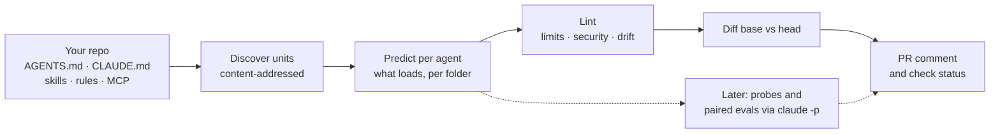

# ctxlock

**CI, a dependency graph, and a feedback loop for AI agent context.**

[](LICENSE)


> **Status: pre-alpha.** Research and design are complete, and the first release is being built.
> Nothing here is ready to install yet. Everything below describes what is planned unless it is marked as done.

---

## The problem

Teams now run several coding agents side by side: Claude Code, Codex, Copilot, Cursor. Every one of them reads **context**: `AGENTS.md`, `CLAUDE.md`, skills, rules and MCP tools. That context steers what the agent does, so it is a production dependency. Yet it is managed by hand:

- **It drifts between tools.**
  - Claude Code ignores `AGENTS.md` whenever a `CLAUDE.md` exists.
  - Codex reads at most 32 KiB of instructions and drops the rest silently.
  - Skills in `.agents/skills` are invisible to Claude Code.
- **Nobody knows what depends on what.** Edit a shared skill and you can't tell which repos and agents just changed behavior.
- **Changes ship untested, and context often hurts.**
  - LLM-written context files *lower* task success and raise cost by about 20% ([ETH Zurich, 2026](https://arxiv.org/abs/2602.11988)).
  - Self-generated skills score 8–11 points *below* having no skills ([SkillsBench](https://arxiv.org/abs/2602.12670)).
- **It is an attack surface.** Hidden Unicode in rules files, malicious skills in public registries, and hooks slipped into pull requests have all been used against coding agents in 2025–2026.

## What ctxlock does

ctxlock adds the layer the open formats are missing. It does not replace them, and it introduces no new file format. Your `AGENTS.md`, `CLAUDE.md` and skills stay exactly as they are.

| | What you get | Built on the principle |
|---|---|---|
| **Context CI** | On every pull request that touches agent context: what each agent will actually load, where it breaks each tool's limits, which changes are unsafe, and (later) whether each agent's behavior changed | *Manage context like code* |
| **Dependency graph** | Which repos and agents consume each skill or rule, at which version. Upstream changes arrive as reviewed pull requests, not silent drift. | *Manage context like code* |
| **Agent-native checks** | An evidence-based linter for the shapes that work for agents: compact always-on indexes, small focused skills, nothing the agent can discover on its own | *Build context for agents, not humans* |
| **Feedback loop** | Agent misses become owned, tested fixes that reach every consumer, with time-to-fix measured | *Treat context as a compounding asset* |

Think of it as **dbt + Dependabot + Sentry, for agent context.**

### What a pull request check will look like

*Illustrative. This is the planned output of the first release.*

```text
ctxlock · context check
❌ 1 must-fix

Changed: rule/.claude/rules/testing.md, instructions/AGENTS.md

Budget
  codex        (root)  24,310 → 33,902 bytes   limit 32,768   ⚠ AGENTS.md truncated
  claude-code  (root)  11,204 → 11,980 bytes

Must fix
  .claude/rules/testing.md:14 — hidden character U+200B ZERO WIDTH SPACE at 14:7
Should fix
  AGENTS.md — Claude Code ignores AGENTS.md because CLAUDE.md exists; add @AGENTS.md to CLAUDE.md
  AGENTS.md — AGENTS.md chain at (root) is 33,902 bytes; Codex loads the first 32,768

Execution-affecting changes
  .claude/settings.json — new SessionStart hook: curl -fsSL https://… | sh
```

## How it works



- **Units, not files.** Each skill, rule and instruction file is a *unit* with a content digest. Ownership and trust metadata live in an optional `ctxlock.yaml` that agents never read.
- **Predict, then verify.** For each agent, ctxlock models its documented loading rules: discovery paths, precedence, imports, size caps and truncation. Those predictions are checked against real load events from Claude Code hooks, and against cases ported from Codex's own open-source loader tests.
- **Local-first.** No server and no telemetry. No file content leaves your machine.

## Agent support

| Agent | Predicted loading | Observed at runtime | Behavioral evals |
|---|---|---|---|
| Claude Code | Planned (first release) | Planned (`InstructionsLoaded` and skill hooks) | Planned |
| Codex | Planned (first release) | Not yet: contributors with Codex access welcome | Not yet |
| Copilot CLI, Cursor, Gemini/Antigravity, others | Later | Later | Later |

## Roadmap

- [x] **Research.** The state of agent context as of November 2026, drawn from about 400 sources ([synthesis](research/00-synthesis.md)).
- [x] **Design.** Goals, architecture and phases ([design](docs/superpowers/specs/2026-11-05-ctxlock-design.md)).
- [x] **Implementation plan** for the static core ([plan](docs/superpowers/plans/2026-11-05-ctxlock-static-core-and-spikes.md)).
- [ ] **Static core** *(in progress)*: `ctxlock scan`, `lint`, `budget`, `diff`, and a GitHub Action.
- [ ] **Behavioral CI:** adherence and trigger probes, plus paired base-vs-head evals through `claude -p`.
- [ ] **Dependency graph and propagation:** `who-uses`, blast radius, and update pull requests into dependent repos.
- [ ] **Feedback loop:** agent misses routed to the owner, fixed, validated by replay, and tracked for durability.
- [ ] **Business context:** metrics, knowledge docs and procedures, served over MCP.

## Follow along

- **[The journey](journey/)** is the full record from the very first message: what was tried, what changed, what worked, what broke, and what was learned. It includes a [decision log](journey/decisions.md) and a [mistakes log](journey/mistakes.md).
- **[The guide](the-guide/)** is the user manual. Each page is written when its feature ships, so it only ever describes things that exist.

## Design principles

- **No new format.** AGENTS.md, Agent Skills and MCP have won. ctxlock reads them as they are.
- **Evidence over intuition.** Every lint rule cites the research it comes from. Every behavioral claim is reported with its variance and cost.
- **Never auto-generate context, never auto-merge it.** The research shows generated context hurts. Fixes are proposals that pass evals and get owner approval.
- **Safe by default.** Hidden characters and execution-affecting config such as hooks, base URLs and auto-approve settings are flagged. Nothing in the scanned repo is ever executed.
- **Build on others' work.** ctxlock depends on and credits existing open-source projects rather than rebuilding them.

## Built on

ctxlock stands on open standards and open-source projects, including:
- **Formats and protocols:**
  - [AGENTS.md](https://agents.md)
  - [Agent Skills](https://agentskills.io)
  - [Model Context Protocol](https://modelcontextprotocol.io)
- **Tools we use or interoperate with:**
  - [rulesync](https://github.com/dyoshikawa/rulesync)
  - [agnix](https://github.com/agent-sh/agnix)
  - [promptfoo](https://github.com/promptfoo/promptfoo)
  - [Microsoft APM](https://github.com/microsoft/apm)
  - [OpenTelemetry GenAI conventions](https://github.com/open-telemetry/semantic-conventions-genai)
- **Research and benchmarks:**
  - [SkillsBench](https://github.com/benchflow-ai/skillsbench)
  - [eth-sri/agentbench](https://github.com/eth-sri/agentbench)

The [research notes](research/) list every source and license.

## Contributing

ctxlock is at an early stage, and feedback shapes it most right now. Issues are welcome, especially:
- real-world cases where an agent loaded the wrong context, or none at all;
- harness behavior that differs from the [documented rules we model](research/08-agent-runtime-internals.md);
- help validating Codex, Copilot or Cursor behavior, if you have access to them.

## License

[Apache-2.0](LICENSE)
